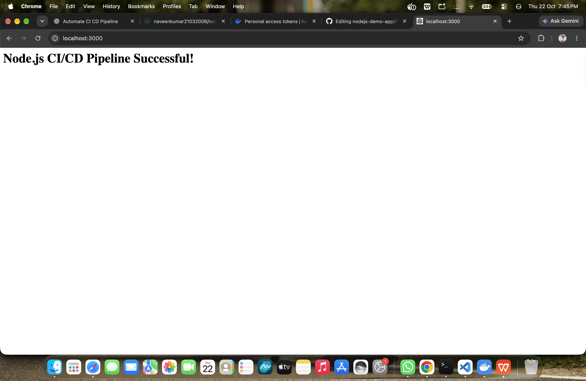

# Node.js CI/CD Pipeline

## Objective
Automate testing, Docker image building, and image publishing using GitHub Actions.

## Tools
- Node.js
- Git and GitHub
- GitHub Actions
- Docker
- Docker Hub

## Pipeline
1. Trigger on push to the `main` branch.
2. Check out the source code.
3. Install Node.js dependencies.
4. Run automated tests.
5. Build a Docker image.
6. Push the image to Docker Hub.

## Run Locally

```bash
npm ci
npm test
npm start
```

Open http://localhost:3000 to view the application.

## Run with Docker

```bash
docker build -t nodejs-demo-app .
docker run --rm -p 3000:3000 nodejs-demo-app

```

## Application Screenshot

The Node.js application is running successfully inside a Docker container.



## Security
Docker Hub credentials are stored as GitHub Actions repository secrets and are not hardcoded in the workflow.

## Outcome
A push-triggered CI/CD pipeline that tests the application and publishes its Docker image to Docker Hub.
